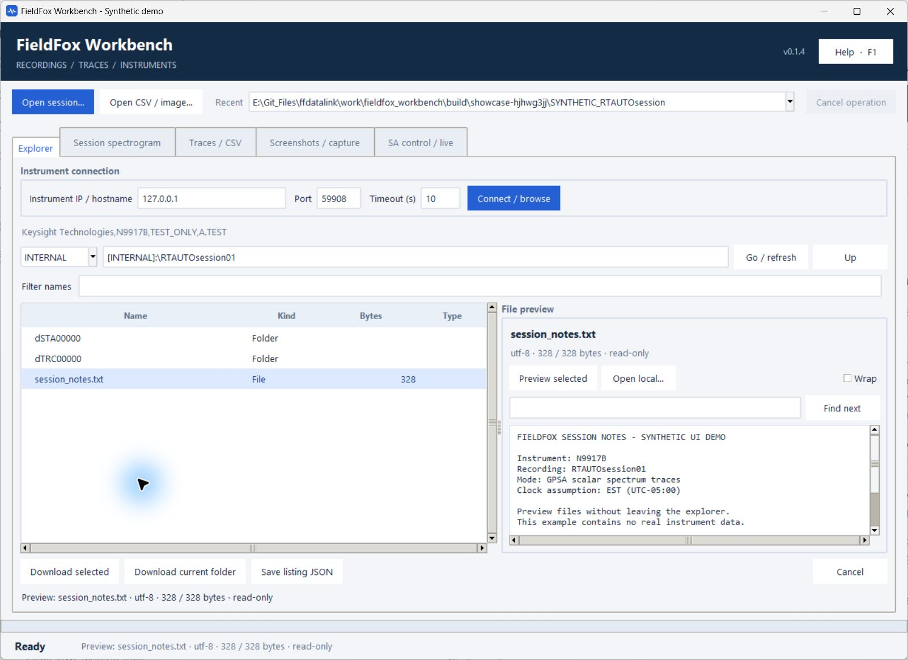
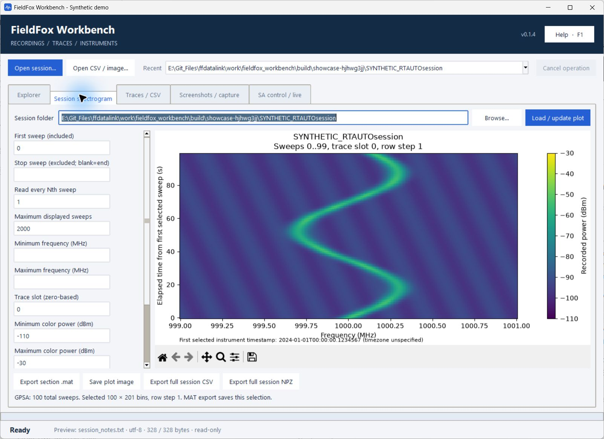
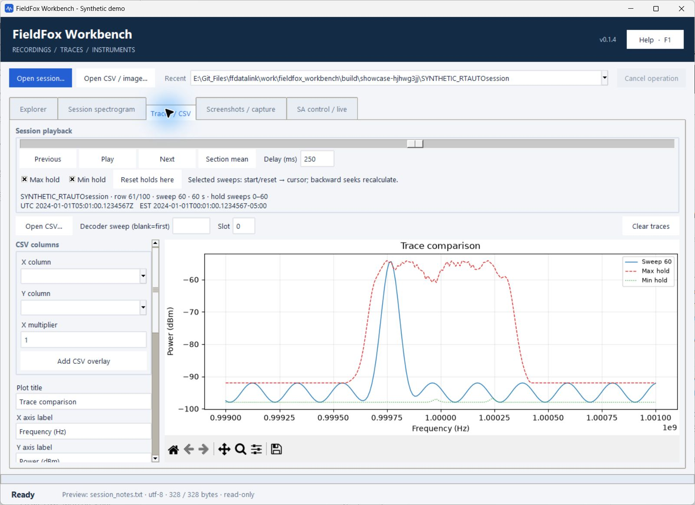
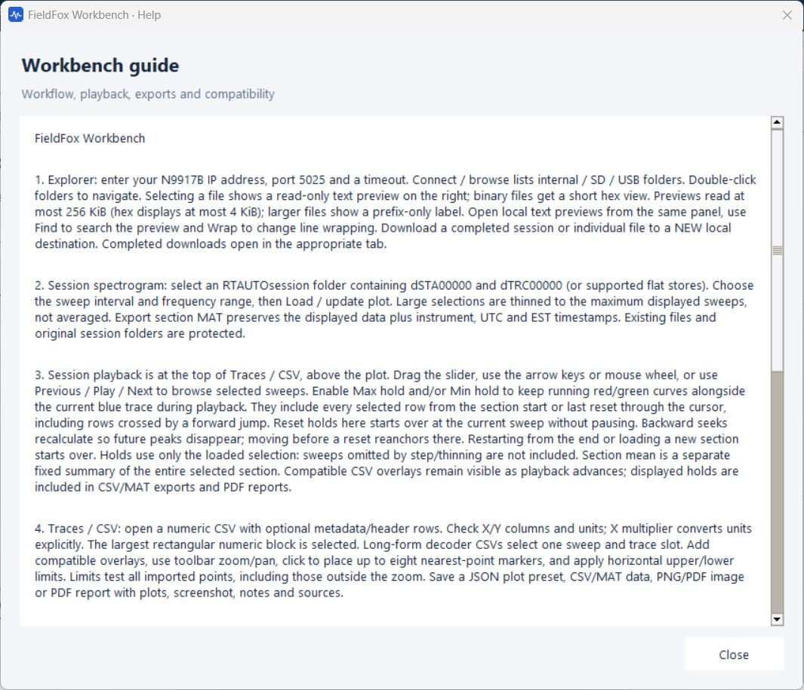

# FieldFox Workbench: screenshot tour

Actual Windows screenshots of **v0.1.4**, using a synthetic 100-sweep recording
and a local simulated instrument. No real measurement data or live analyzer was
used. The loopback address and temporary demo folder shown are for this example.

## Explorer and file preview

Browse instrument folders on the left and read the selected file on the right.
The split is resizable. Preview includes encoding, byte count, search and line
wrapping; binary files show hex. Reads are limited to 256 KiB.

## Session spectrogram and exports

Select sweeps, frequency limits and color settings in the scrollable sidebar.
The plot supports zoom and pan. **Export section .mat** saves the displayed
selection, including UTC and EST timestamps; EST means fixed UTC−05:00.
The load action stays above the plot and the export buttons stay below it.
In v0.1.5, **Export full session MAT** also saves every sweep, stored trace and
bin into numbered parts; it ignores plot selection controls. See the
[MAT export guide](MAT_EXPORT.md). The screenshot below shows the earlier v0.1.4 layout.

## Playback, max hold and min hold

Playback controls share the **Traces / CSV** page with the plot. Drag the slider
or use Previous, Play and Next. The blue curve is the current sweep, red dashed
is max hold and green dotted is min hold. Both holds can run together; **Reset
holds here** starts a new interval. UTC and EST appear beside the sweep details.
CSV column mapping and plot settings are in the scrollable left sidebar.

## Help button and separate guide

The header's **Help · F1** button opens this scrollable guide in a separate
window. Press F1 from the main window to open it, or Escape to close the guide.
The main workspace has five tabs and no Help tab.

[Download the one-file Windows application](https://github.com/NicolasSayed/fieldfox_workbench/releases/latest)
or return to the [README](../README.md).
